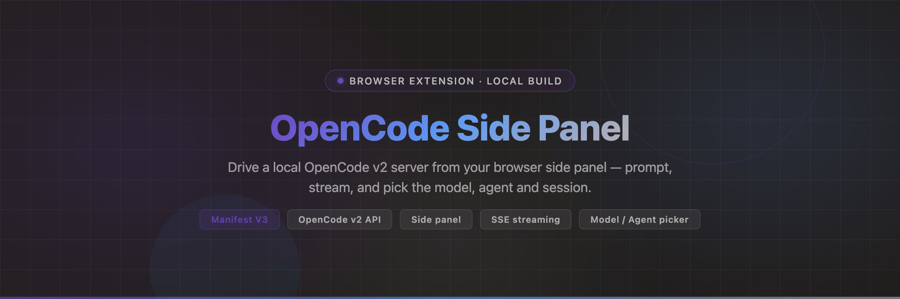

<p align="center">
  
</p>

<p align="center">
  <strong>Drive a local OpenCode v2 server from your browser side panel — prompt, stream, and pick the model, agent and session.</strong>
</p>

<p align="center">
  <a href="./manifest.json"></a>
  <a href="https://opencode.ai"></a>
  <a href="./manifest.json"></a>
  <a href="./README-LOCAL-BUILD.md"></a>
</p>

---

An unpacked **Manifest V3 side-panel extension** that talks to a local **OpenCode v2** server.
Send a prompt, watch the agent stream its answer, answer permission and form prompts, and scope
everything to a workspace directory — without leaving the browser.

This is the browser extension, ported to the OpenCode **v2** HTTP API. The store build speaks v1
and cannot talk to a v2 server; this one replaces it. If you are installing for the first time,
[`README-LOCAL-BUILD.md`](./README-LOCAL-BUILD.md) has the step-by-step. The full v1 → v2 route
mapping and the reasoning behind it live in
[`MIGRATION-PLAN-opencode-v2.md`](./MIGRATION-PLAN-opencode-v2.md).

---

## Features

- **Prompt and stream** — type in the side panel; the reply streams back over `GET /api/event` (SSE).
- **Model picker** — choose the model for the active session, grouped by provider. Applies via
  `POST /api/session/{id}/model`.
- **Agent picker** — choose the agent for the active session via `POST /api/session/{id}/agent`.
- **Session picker** — auto-detects every session of the current workspace and lets you switch.
  On switch, the model and agent dropdowns re-seed from that session, so they always reflect reality.
- **Workspace scoping** — a directory is sent as `?directory=` on almost every call, so the server
  works inside the project you selected rather than its own working directory.
- **Tab context** — attach the readable content of open browser tabs to the prompt.
- **Permissions and questions** — tool permission prompts and agent questions render as cards you
  can answer inline.
- **Visible failures** — when a run fails (quota, provider error), the reason is shown in the
  transcript instead of an empty screen.
- **New session** — when no session is selected, the chat area is replaced by a single
  **New session** button.

---

## Quick Start

You need an OpenCode v2 server running locally first.

**1. Read your server port and password**

```bash
cat ~/.config/opencode/service.json
```

```json
{ "port": 49376, "password": "…", "hostname": "0.0.0.0" }
```

**2. Load the extension**

1. Disable the store version of *OpenCode* in `edge://extensions` (or `chrome://extensions`) so
   the two do not conflict.
2. Enable **Developer mode** → **Load unpacked** → pick this folder.

**3. Configure it**

Open the side panel, click the gear (Settings) and fill in:

- **Server URL** — `http://localhost:49376` (the `port` from `service.json`)
- **Username** — `opencode`
- **Password** — the `password` from the same file

The status dot turns green and shows `OpenCode <version>`. The extension cannot read
`service.json` itself, so the URL and password stay manual.

---

## Usage

### The picker bar

Three dropdowns sit in a bar directly above the prompt input:

- **Model** — grouped by provider. Picking one applies it to the **active session** immediately.
  The first entry is *session default* (no override).
- **Agent** — the agents the server exposes for this workspace (`GET /api/agent?directory=…`).
- **Session** — every session belonging to the current workspace. Selecting one switches to it and
  reloads its messages.
- **⟳** — re-scan sessions, models and agents in one go.

Selections are persisted in `chrome.storage.local` (`selectedModel`, `selectedAgent`).

### Model quota

Free models are metered by the server. When the quota is exhausted the run fails with
`Free usage limit reached` — that message is now shown in the transcript. Pick a non-free model in
the dropdown, or subscribe, to keep going.

---

## Architecture

Three files carry the logic; everything else is assets and icons.

- **`background.js`** — the service worker. The single translation point between the sidebar's
  v1-style message protocol and the v2 HTTP API: it rewrites paths, unwraps v2 envelopes
  (`{data:[…]}`), maps v2 messages into the shape the sidebar renders, and translates the
  `/api/event` stream back into the v1 event shape. It is also the only place that knows the
  workspace `directory`.
- **`sidebar.js`** — the React side-panel app (compiled, readable, not minified). It owns the UI:
  header, transcript, working indicator, permission and question cards, input area, pickers.
- **`assets/protocol-*.js`** — the message-name constants shared by both sides.
- **`assets/sidebar-*.css`** — the panel stylesheet and design tokens.

```
sidebar  --(v1-style message)-->  background.js  --(v2 HTTP / SSE)-->  opencode v2 server
sidebar  <--(v1-shaped event)---  background.js  <--(SSE /api/event)--
```

### v1 → v2 routes

All translation happens in `background.js`:

- health-check → `GET /api/info`
- api-request `/session` → `GET /api/session?directory=…` → `{data:[…]}`
- api-request `/session/{id}/message` → `GET /api/session/{id}/message`
- api-request `/model` → `GET /api/model?directory=…`
- api-request `/agent` → `GET /api/agent?directory=…`
- api-request `/session/{id}/model` → `POST /api/session/{id}/model` with `{model:{id, providerID}}`
- api-request `/session/{id}/agent` → `POST /api/session/{id}/agent` with `{agent}`
- send-prompt → `POST /api/session/{id}/prompt` with `{id, text}`
- abort-prompt → `POST /api/session/{id}/interrupt`
- subscribe-events → `GET /api/event` (SSE)

### Message IDs

The v2 API validates that a prompt `id` starts with `msg_` (`Session.Message.ID`). `background.js`
generates `msg_` + 26 base62 characters with `crypto.getRandomValues`. A plain
`crypto.randomUUID()` is rejected with `400 Expected a string starting with "msg_"`.

### Streaming and message roles

v2 emits no `message.updated` event. The sidebar only renders text parts it already knows belong to
the assistant, so `background.js` synthesises that announcement once per assistant message, from the
raw v2 event, before any delta is forwarded. Without it every streamed token is silently dropped.

---

## Logs

Three layers, all readable:

1. **Service worker** — `chrome.storage.local` key `ocLogs`, a ring of 1000 that survives the worker
   being killed. From any extension page:

   ```js
   chrome.storage.local.get("ocLogs").then(s => console.table(s.ocLogs.slice(-100)))
   ```

2. **Sidebar** — `window.__ocLog`, a ring of 3000, plus the console:

   ```js
   JSON.stringify(window.__ocLog.slice(-100))
   window.__ocDumpBg()   // the worker's ring, from the side panel
   ```

3. **Live console** — the service worker (via `edge://extensions` → *service worker*) and the side
   panel both log with `[oc-bg …]` and `[oc-sidebar …]`.

Everything is logged: each request (v1 path → v2 path, method, truncated body, status, truncated
response), each SSE event, each prompt, health checks and errors.

---

## Requirements

- A local **OpenCode v2** server (the `service.json` port and password).
- **Microsoft Edge** or **Google Chrome** with Developer mode enabled, for `Load unpacked`.
- A workspace directory set in the panel before session listing becomes meaningful — sessions are
  scoped by `?directory=`. Use an **absolute** path; `~` is not expanded by the server.

---

## Known limits

- Only the first model reference is sent per pick; there is no per-model `variant` sub-menu, so the
  session default variant is used.
- The prompt body carries `agents` in the protocol, but this build sets the agent at the **session**
  level via `/api/session/{id}/agent`, which is what the TUI does.
- The SSE stream is global (`/api/event`) and filtered on the subscribed session; it stays open when
  the side panel closes.
- Session, model and agent lists are scoped by `?directory=<workspace>`. With no workspace set, the
  server falls back to its own default project.
- The exact `data` shape of a few events was read from the bundled v2 schema rather than captured
  live for every event type.

---

## Contributing

Issues and pull requests are welcome. Before opening a PR, please:

- Keep the translation layer honest — v2-specific handling belongs in `background.js`, not scattered
  through `sidebar.js`.
- Verify against a real server, not by inspection: console logs plus network, not a screenshot.
- Describe the v1 path and the v2 path for any route you touch.

---

## License

No `LICENSE` file is included yet, so this repository is currently **all rights reserved** by
default. Add a license before accepting contributions or reuse.
